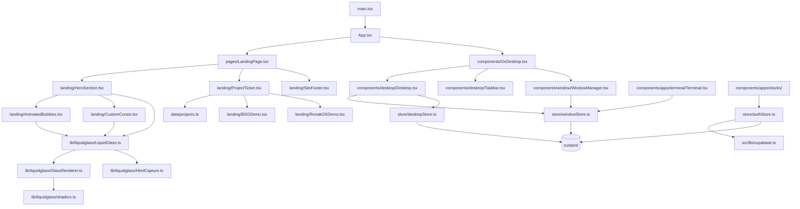

# Technical Design Document

## Overview
This document provides a high-level technical overview of the codebase, its architecture, main modules, data flow, and key design decisions. It is intended to help new developers and maintainers quickly understand the structure and interactions within the project.

The repo hosts **two surfaces**: a light-mode marketing/landing site (`ronakchavva.com`) and a desktop-grade OS portfolio (`os.ronakchavva.com`), selected at runtime by subdomain.

---

## 1. Project Structure

```
index.html
package.json
postcss.config.js
tailwind.config.js
tsconfig.json
vercel.json
vite.config.ts
scripts/
  seed-prices.js
src/
  App.tsx                      (router + subdomain switch)
  main.tsx                     (StrictMode + BrowserRouter)
  vite-env.d.ts
  components/
    landing/
      HeroSection.tsx          (liquid-glass hero)
      AnimatedBubbles.tsx      (WebGL2 SDF bubble background + spring physics)
      CustomCursor.tsx         (refractable cursor replica set)
      ProjectTicker.tsx        ("The Wire" infinite project ticker)
      BSGDemo.tsx              (live BSG/LeetCode mock, `active`-gated)
      RonakOSDemo.tsx          (live space/black-hole canvas sim, `active`-gated)
      BubbleCard.tsx           (legacy, unused by landing)
      SiteFooter.tsx           (contact links + copy-to-clipboard email)
    desktop/
      Desktop.tsx
      DesktopIcon.tsx
      GravityControls.tsx
      SpaceBackground.tsx
      Taskbar.tsx
      BootScreen.tsx
    window/
      Window.tsx
      WindowManager.tsx
    apps/
      stocks/
      terminal/
        commands.ts
        Terminal.tsx
        useTerminal.ts
    OsDesktop.tsx              (OS shell: boot, desktop, windows, taskbar)
  data/
    projects.ts                (ticker content: append an object = new project)
  lib/
    supabase.ts
    liquidglass/               (vendored @ybouane/liquidglass, MIT — WE OWN IT)
      LiquidGlass.ts           (orchestrator: capture, compositing, loop, input)
      GlassRenderer.ts         (WebGL pipeline + water-edge uniforms)
      HtmlCapture.ts           (DOM snapshotting via html-to-image)
      shaders.ts               (glass GLSL incl. water-edge SDF)
      defaults.ts              (all tunables incl. flow*/mouseAmp)
      index.ts
  store/
    authStore.ts
    desktopStore.ts
    windowStore.ts
  styles/
    globals.css
public/
  resume.pdf
```

---

## 2. Main Modules & Responsibilities

### Entry Point & Routing
- **main.tsx**: StrictMode + BrowserRouter bootstrap.
- **App.tsx**: subdomain switch — `os.*` host renders `OsDesktop` directly; otherwise routes `/` → landing, `/os` → redirect to `os.ronakchavva.com`, `*` → `/`.

### Landing (`/` — light theme, toybox philosophy)
- **pages/LandingPage.tsx**: composes `HeroSection` → `ProjectTicker` → `SiteFooter` inside the `.landing-page` scroll container.
- **HeroSection.tsx**: owns the liquidglass `root` (flex column). Direct children, in order: bubble canvas, cursor canvases, name glass panel, CTAs. CTAs live **outside** the glass panel (refracted pixels and DOM hitboxes don't align — clicks inside glass feel broken). Scroll-fades hero elements via opacity.
- **AnimatedBubbles.tsx**: fullscreen WebGL2 lava-lamp background. 5-blob SDF scene (3 main + 2 satellites) rendered as a crisp rainbow rim with hollow transparent insides on a transparent canvas (`data-dynamic`, so the glass re-captures it every frame). A JS spring sim (per-blob offset + velocity, damped spring home) drives `u_off[5]` offsets: cursor repulsion with frozen-core direction (no singularity jitter), click-to-poke radial kicks, and a one-time scripted sweep ~1.2s after load that teaches visitors the page is alive. Portrait zoom-fit + vertical clamps keep rims on screen; DPR capped (2 desktop / 1.5 mobile); loop pauses offscreen; static frame under reduced motion.
- **CustomCursor.tsx**: the OS cursor can't be captured by any website, so this draws a pixel-faithful replica (hand-drawn arrow + mocu-xcursor CC0 hand for links) as DOM content the glass *can* refract. Dual canvases, one rAF loop: hero canvas (z 1, `data-dynamic`, refracts through the name glass) + page canvas (z 50, portalled to `document.body` so it escapes the hero's stacking context and stays visible over the opaque projects band). 1:1 tracking, `.has-custom-cursor` hides the OS cursor; active only with fine pointer and no reduced-motion preference.
- **ProjectTicker.tsx** ("The Wire"): data-driven infinite project band (right → left). Two identical halves, `translateX(-50%)` loop, gap baked inside cards (no seam twitch), duration measured from content width for constant px/s. Pauses on hover, keyboard focus, and touch-hold; dup half is `aria-hidden` + non-interactive; focus is released on tab-return so the ticker never stays stuck. Each card IO-gates its demo's `active` prop. Reduced motion → static grid.
- **data/projects.ts**: ticker content model (`bsg | ronakos | poster` demo kinds; `poster` = static card for projects without a sim yet).
- **BSGDemo.tsx**: mock LeetCode + live party-chat sim (3s message cadence); loop gated by `active`.
- **RonakOSDemo.tsx**: black-hole gravity canvas sim (nebulae, stars, collision debris, desktop icons); loop gated by `active`; counts/DPR scaled down on narrow screens.
- **SiteFooter.tsx**: punchline + GitHub / LinkedIn / RonakOS links, plus an **Email copy button** (writes `ronakch8@gmail.com` to the clipboard with a "copied!" confirmation — no `mailto:` link). There is no Resume link here; the resume is downloadable only via the OS terminal easter egg (`curl -O resume.pdf`).

### OS (`os.*` — dark theme, desktop metaphor)
- **OsDesktop.tsx**: boot gate (sessionStorage), desktop, window manager, taskbar, gravity controls, cursor black-hole mode.
- **components/desktop/**, **window/**, **apps/**: draggable-icon desktop, stacking window manager, terminal (virtual FS with `about.txt`, downloadable `resume.pdf`) and stocks apps.

### Vendored liquidglass (`src/lib/liquidglass`, MIT)
Copied from `@ybouane/liquidglass` v1.0.3 (package dep removed) so the glass can be modified freely. Extensions beyond upstream:
- **Water-edge SDF** (`glassSDF` in `shaders.ts`): rounded rect + animated angular harmonics + pointer dent. Mask, normals, shadow, and refraction all derive from it, so lighting stays correct while edges slosh.
- New uniforms/time/mouse plumbing through `GlassRenderer.renderGlassPanel` (fed per-frame from `LiquidGlass`, which tracks the pointer).
- New `GlassConfig` fields: `flowAmp` (default 6), `flowSpeed`, `flowSeed`, `mouseAmp` (default 12) — settable per element via `data-config` JSON.

### State Management
- **store/**: Zustand — auth (Supabase), desktop (icons/layout), window (stack/focus).

### Backend Integration
- **lib/supabase.ts**: Supabase client (auth + price seeding via `scripts/seed-prices.js`).

### Styles
- **styles/globals.css**: Tailwind + all landing CSS (hero, ticker, demos, footer, cursor, responsive breakpoints, reduced-motion fallbacks).

---

## 3. Data Flow & Interactions

- **main.tsx** → **App.tsx** → subdomain? **OsDesktop** : Routes → **LandingPage** → [HeroSection, ProjectTicker, SiteFooter]
- **HeroSection** → `LiquidGlass.init({ root, glassElements })`; bubble canvas + cursor canvases feed the glass scene every frame via `data-dynamic` re-capture.
- **AnimatedBubbles** spring sim → `u_off[5]` → shader offsets (pre-clamp, so containment holds).
- **ProjectTicker** → `data/projects.ts` → cards → `active` → demo loops.
- **OsDesktop** → Desktop/Taskbar/WindowManager → windowStore; terminal/stocks as apps.
- All stores use Zustand; Supabase for auth/data.

---

## 4. Key Design Decisions

- **Two surfaces, one repo**: clean light landing for everyone + full OS experience on a subdomain, split by hostname at runtime.
- **Toybox landing**: every section must be playable (push/poke/stir/scroll) — content is a reward for playing, never held hostage.
- **Vendor, don't wrap, the glass**: the effect is now first-party code; visual experiments happen in `shaders.ts`/`defaults.ts`, not config strings.
- **Visibility-gated animation**: every rAF loop (bubbles, demos, glass) pauses offscreen and under reduced motion; mobile gets reduced counts + DPR caps.
- **Data-driven ticker**: new projects are data, never layout surgery.
- **Vite + Tailwind + TypeScript**; Zustand over heavier state; Supabase for backend.

### Hard-won gotchas (read before touching)
- WebGL canvases need `preserveDrawingBuffer: true` or the glass snapshot reads them back blank.
- Never `loseContext()` in effect cleanup under StrictMode — remounts reuse the canvas's context object and stay blank forever.
- Center glass panels with flexbox, not `absolute` + `translate(-50%)` (breaks on mobile Safari).
- Interactive content goes OUTSIDE glass panels — refraction displaces pixels away from DOM hitboxes.
- `position: fixed` inside a stacking-context ancestor (hero has `z-index: 1`) paints below later opaque sections — portal such layers to `document.body`.
- A GLSL compile error blanks the canvas silently — check the console; duplicate declarations are the usual killer.
- Seamless marquee rule: gap inside items only, halves pixel-identical, `width: max-content`, translate exactly `-50%`.
- Physics offsets apply BEFORE containment clamps in-shader; direction vectors freeze near cores to avoid singularity jitter.

---

## 5. External Dependencies

- **React / React DOM**: UI framework.
- **react-router-dom**: landing routes + `/os` redirect.
- **Zustand**: state management.
- **Supabase**: backend as a service.
- **framer-motion**: (installed, available for UI animation).
- **html-to-image**: DOM snapshotting for the glass pipeline.
- **Vite / Tailwind CSS / TypeScript**: tooling, styling, types.
- Removed: `@ybouane/liquidglass` (vendored into `src/lib`), `matter-js` (skill-spirits experiment removed).

---

## 6. Architecture Diagram



---

## 7. References
- [Supabase Docs](https://supabase.com/docs)
- [Zustand Docs](https://docs.pmnd.rs/zustand/getting-started/introduction)
- [Vite Docs](https://vitejs.dev/)
- [Tailwind CSS Docs](https://tailwindcss.com/docs)
- [React Router Docs](https://reactrouter.com/)
- [Framer Motion Docs](https://motion.dev/)
- [mocu-xcursor (CC0 cursor art, hand glyph source)](https://github.com/sevmeyer/mocu-xcursor)
- [OpenMoji (CC BY-SA 4.0, evaluated for cursor art)](https://openmoji.org/)

---

_Last updated: October 9, 2026_
